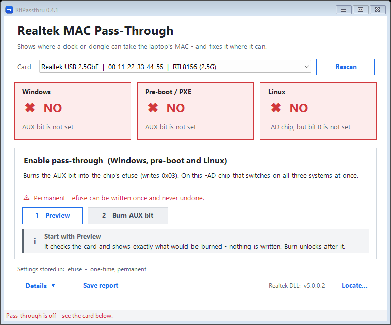
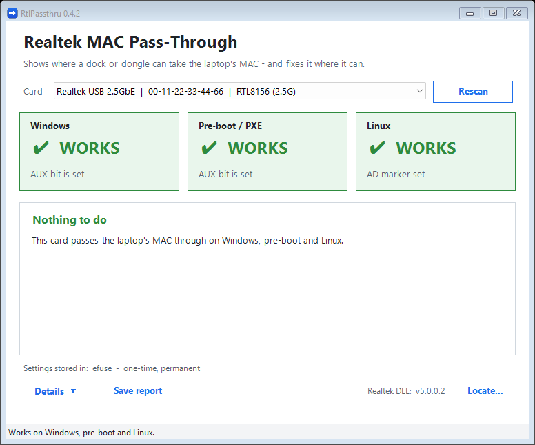
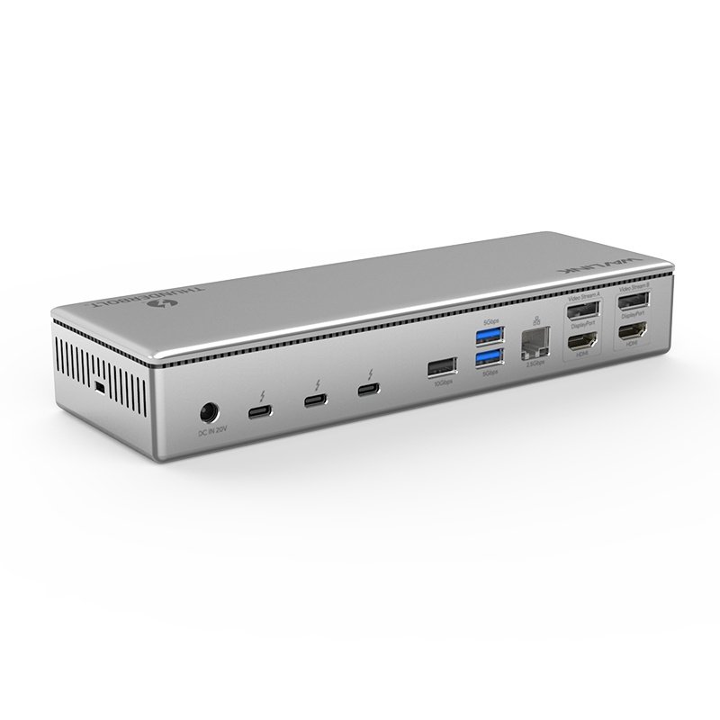
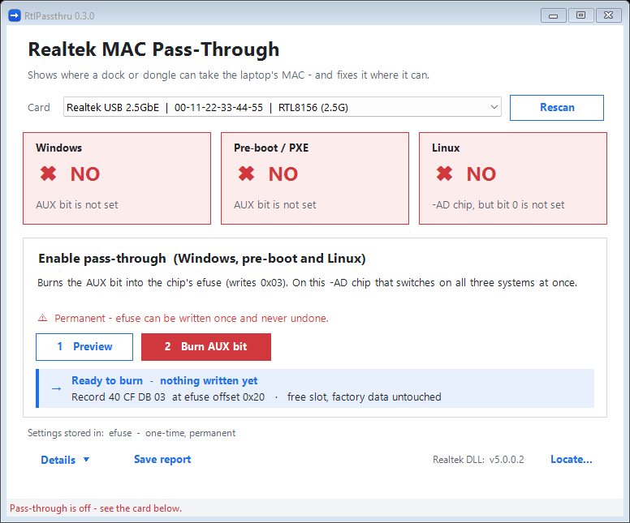
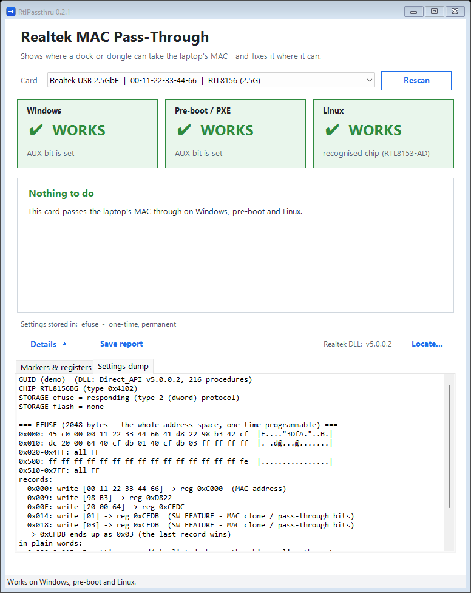

# Enable MAC Address Pass-Through on Thunderbolt / USB docking stations (and dongles)

**Thunderbolt and USB-C docks, and USB Ethernet dongles, use a Realtek chip for their wired network.
Many ship with MAC Address Pass-Through switched off. RtlPassthru checks your adapter and switches it
on.**

When you dock a laptop, the dock's Ethernet port goes online under *its own* MAC address, not the
laptop's. On corporate and campus networks that breaks things — access control, licensing, DHCP
reservations and PXE/network boot are all tied to the **laptop's built-in** MAC. **MAC Address
Pass-Through** is the fix: the dock borrows the laptop's MAC, so the network sees the same machine
whether you're docked or not. Business laptops offer it through a firmware value called `_AUXMAC_` —
Dell's BIOS setting *"MAC Address Pass-Through"*, and the same feature on Lenovo and HP.

Here's the catch, and the reason this tool exists: **some docks simply don't accept it — and it has
nothing to do with price.** The capability is just one bit inside the Realtek chip, and on some units
it's left unset at the factory. We hit it on a **premium Thunderbolt 4 dock**. The good news is that
it's exactly one bit — and RtlPassthru can burn it in.

| It can't (yet) | …now it can |
|---|---|
|  |  |

> Screenshots use sample data (a made-up MAC). Nothing personal is shown.

---

## How it works

At power-on the chip loads a capability byte — register **`0xCFDB`** — from its internal memory, and
the Realtek driver passes the laptop's MAC through **only if the right bit in that byte is set.**

`0xCFDB` carries two independent switches:

- **AUX-clone** — the standard `_AUXMAC_` pass-through used by Dell / Lenovo / HP. **This is the gate.**
- **RT-clone** — a separate Realtek-only clone mode. It does **not** affect pass-through.

What decides it is **which switch is on, not how big the number looks:**

| `0xCFDB` | AUX-clone | pass-through? | what it is |
|:---:|:---:|:---:|---|
| `0x00` | off | ✗ | blank chip |
| `0x01` | off | ✗ | **RT-clone only — what an unsupported dock ships with** |
| `0x02` | on  | partly | AUX only — Windows yes; Linux no on `-AD` chips; pre-boot untested |
| `0x03` | on  | ✓ | both switches — **what RtlPassthru writes** |

So an unsupported dock usually reads **`0x01`**: a clone bit *is* set, which makes it look capable —
but it's the **wrong** switch (RT instead of AUX), and pass-through silently never happens. Turning
the AUX switch on is the whole fix — and RtlPassthru writes **`0x03`**, both switches, exactly like a
dock that ships enabled: Linux on `-AD` chips needs the RT bit too, and pre-boot was verified with
`0x03`. *(The exact driver logic is in the [deep dive](#deep-dive).)*

**Why it's a "burn".** `0xCFDB` lives in the chip's **efuse** — a one-time-programmable (OTP) memory:
each bit can be set once and never cleared. RtlPassthru doesn't edit the existing value; it **appends
one 4-byte record (`40 CF DB 03`) into blank space** at the end of the efuse, which the chip reloads
at every power-on. Factory data is never touched, so a failed or interrupted burn simply doesn't take
and leaves the card unharmed. Because it's irreversible, the tool always offers a **dry run** first.

---

## The dock that started this

The one that set this off was not a bargain-bin part — it was the **WAVLINK ThunderDock Quattuor Pro
(WL-UTD41)**, a premium 40 Gbps, 15-in-1 Thunderbolt 4 docking station
([WAVLINK](https://www.wavlink.com/en_us/product/WL-UTD41.html) ·
[Amazon](https://www.amazon.co.uk/dp/B0CMHN2MZH)).



*Photo: WAVLINK (manufacturer). Source: the product pages linked above.*

Its 2.5 Gigabit Ethernet is a **Realtek RTL8156** — WAVLINK's spec sheet never names the chip; we
found it by reading the controller directly. Its `0xCFDB` read **`0x01`**: the RT switch on, AUX off
— so this expensive dock would **not** pass the laptop's MAC through, in Windows or at pre-boot. We
burned the AUX switch; it now reads **`0x03`** and passes the MAC through, including Dell's pre-boot
pass-through. It's a **per-unit factory detail — even a premium dock can ship without it.**

**Not sure about yours? Try it on a dongle first.** Any Realtek **RTL8156 (2.5 G)** or
**RTL8153 (1 G)** USB adapter works the same way. We found that a cheap USB 2.5G dongle
([a few pounds on AliExpress](https://www.aliexpress.com/item/1005009390264219.html)) uses the very
same chip, so we ran the whole read → dry-run → burn flow on it first — it enabled pass-through and
**kept working perfectly afterwards** (the burn doesn't harm the device). It's an easy, low-cost way
to get comfortable with the process before touching an expensive dock.


*An inexpensive USB-A 2.5G dongle with the same Realtek RTL8156 as the dock — a handy thing to try
the process on first. Photo: AliExpress listing (linked above).*

---

## Setup

RtlPassthru runs on **Windows x64** and needs **[Python 3.8+](https://www.python.org/downloads/)**
installed — it won't run without it (standard library only, nothing to `pip install`). Your adapter
must also be on a **genuine Realtek driver** (the `rtump64x64` family — it appears as
*"Realtek … USB … Family Controller"*); the generic Microsoft USB driver won't work. Windows Update
usually installs a Realtek one on its own, and if it didn't, you can grab it from the same Realtek
page as the DLL in step 2.

Then:

1. **Get RtlPassthru.** Download the latest **[release](../../releases)** `.zip` and unzip it anywhere
   (or clone this repo).

2. **Add the Realtek DLL.** RtlPassthru drives Realtek's own diagnostic library
   (`RtlDirectDiagLib64.dll` with its companion `RTDiagLibV2.dll`) — Realtek's property, so it is
   **not bundled here.** Grab your own copy (one free download):
   - Open Realtek's **USB Ethernet Family Controller Software** page:
     <https://www.realtek.com/download/List?cate_id=585>
   - Download the **Ethernet Diagnostic Program** (we used **v2.0.8.3**, ~11 MB) and unzip it.
   - From its **`EXE\64\`** folder, copy **both** `RtlDirectDiagLib64.dll` and `RTDiagLibV2.dll` into
     RtlPassthru's **`dll/`** folder.

3. **Run `Card-Inspector.bat`.** It elevates to Administrator and opens the window.

> RtlPassthru identifies the DLL by its exported command set — it shows which it found and how many
> procedures it has, and you can point it anywhere with **Locate…**.

## Using it

**Read the card.** Pick your adapter and press **Read card**. You get a plain verdict — green
**SUPPORTS MAC PASS-THROUGH** or red **NOT SUPPORTED** — with the full reason, like the two
screenshots at the top.

If it's red and you want to fix it, the **Permanent fix** box has two steps.

**Step 1 — Dry run.** The burn is irreversible, so always look before you leap. Dry run reads the
chip, locates the one free slot in the efuse, and shows the exact bytes it *would* write — **without
touching anything.**



**Step 2 — Burn.** Press **Burn AUX bit** and confirm in the dialog. Keep the adapter plugged in and
still while it writes and verifies. Then **unplug and re-plug** it — so the chip reloads the efuse —
and press **Rescan**. It should now read **SUPPORTED**.

Two more buttons help along the way: **Show efuse dump** displays the decoded efuse (read-only), and
**Save report** writes a plain-text summary.



---

## Deep dive

The mechanism in full, for anyone who wants it.

**From efuse to the driver.** `0xCFDB` isn't kept between power cycles — at each power-on it's loaded
from the efuse by an autoload record (`40 CF DB XX`, the `XX` landing in the register). The driver
(`rtump64x64`) then reads `0xCFDB` and builds its own internal byte, `AUXMacType` — **swapping the
weight of the two bits** as it does:

```
0xCFDB  RT-clone  (weight 1)  ->  AUXMacType  bit of weight 2
0xCFDB  AUX-clone (weight 2)  ->  AUXMacType  bit of weight 1   <- the driver tests this one (& 1)
```

Pass-through is applied for exactly `AUXMacType & 1`, and that bit is fed **only** by AUX-clone — so
the numbers differ between the two bytes, but the meaning is the same: *is AUX on?*

| `0xCFDB` | AUX | RT | → `AUXMacType` | `& 1` | pass-through |
|:---:|:---:|:---:|:---:|:---:|:---:|
| `0x00` | 0 | 0 | 0 | 0 | ✗ |
| `0x01` | 0 | 1 | 2 | 0 | ✗ |
| `0x02` | 1 | 0 | 1 | 1 | ✓ |
| `0x03` | 1 | 1 | 3 | 1 | ✓ |

**It works below the OS, not just inside it.** The AUX switch lives in the chip's own firmware, so
pass-through isn't tied to any one operating system:

- **Pre-boot / PXE** — the host firmware programs the MAC into the card *before any OS loads*. We
  tested this on a Dell with BIOS *MAC Address Pass-Through* enabled, and it worked.
- **Windows** — the Realtek driver reads `0xCFDB`, derives `AUXMacType`, and clones the `_AUXMAC_` MAC.
- **Linux** — the `r8152` driver applies the host MAC too, *when the chip is a recognised variant*
  (ours is). Confirmed: our burned RTL8156 came up under the laptop's MAC on Ubuntu.

**Each layer actually checks a *different* thing on the card** — which is why a dock can pass the MAC
through on one OS but not another. The full story is in
**[How MAC Pass-Through Works](docs/how-mac-passthrough-works.md)**.

Because the capability sits in the hardware, network boot already sees the laptop's identity — which
is what makes this useful for imaging and deployment, not just day-to-day docking.

**How we found it.** We read the chip's registers directly over its USB-OCP interface (reproducible,
cross-checked against the device revision) and decompiled the driver to see exactly which bit it
tests.

---

## ⚠️ Safety & disclaimer

- The burn is a **one-time, irreversible (OTP)** write. **Rehearse on a spare first** — a cheap USB
  dongle uses the same Realtek chip, so it's the ideal practice target before an expensive dock.
- It only ever writes into confirmed-blank space; **factory data is never touched**, and a failed or
  interrupted burn leaves the card unharmed.
- Keep the USB connection stable during the burn.
- **It worked for us, but you use this entirely at your own risk — no warranty of any kind.** See
  [LICENSE](LICENSE).

## Under the hood

A thin, layered design — a PowerShell/WinForms window over a small Python backend that talks to the
Realtek library through `ctypes`:

```
Card-Inspector.bat     launcher (self-elevates to admin)
card-inspector.ps1     the window (PowerShell / WinForms)
tools/                 Python backend:
  diag.py                read registers (REV, USB_MISC, 0xCFDB)
  efuse.py               efuse read / dump / dry-run / burn
  rtldiag.py             unified DLL layer (classifies + drives the Realtek library)
  efuse_core.py          pure efuse record logic (unit-tested)
  dll_list.py            lists/classifies the DLLs by command set
tests/                 regression tests  ->  python -m pytest
dll/                   you place the Realtek diag DLL here (not shipped)
```

It reads the `0xCFDB` byte over the chip's USB-OCP interface and, for the burn, drives the efuse
controller with the library's register primitives — appending the autoload record and verifying it
by reading it back.

## Command line (optional)

The window is just a front end — the Python backend runs standalone (same Administrator and DLL
requirements), which is handy for scripting or a headless box:

```powershell
python -I tools/diag.py  {InterfaceGuid}            # read REV, USB_MISC and 0xCFDB
python -I tools/efuse.py {InterfaceGuid}            # dump the efuse
python -I tools/efuse.py {InterfaceGuid} --plan     # dry run: show what a burn would write
python -I tools/efuse.py {InterfaceGuid} --burn     # burn 0xCFDB = 0x03   (irreversible)
python -I tools/dll_list.py                         # list / classify the Realtek DLLs found
```

Get the adapter's GUID with `(Get-NetAdapter).InterfaceGuid`. Add `--dll new|old|auto` to pick a
specific library.
