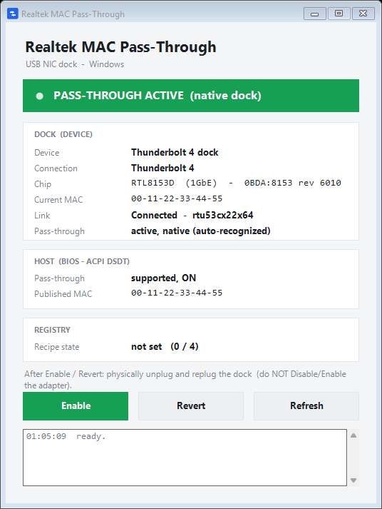
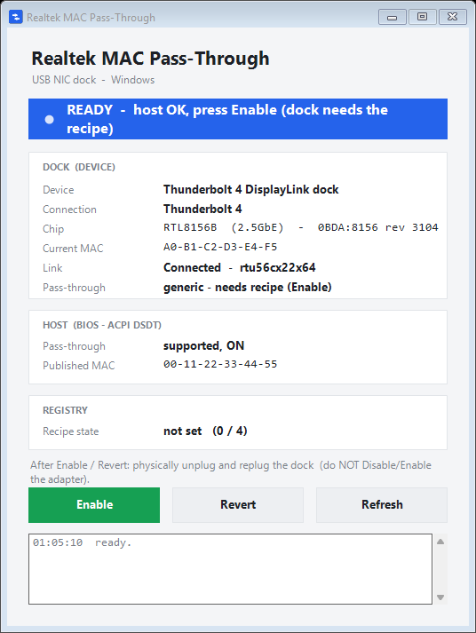
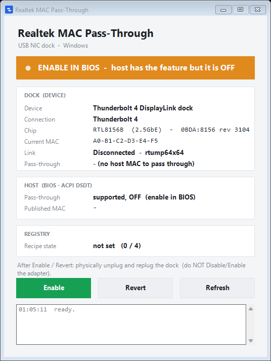
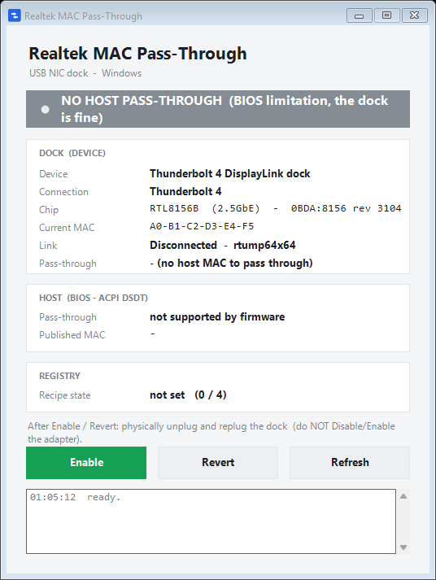
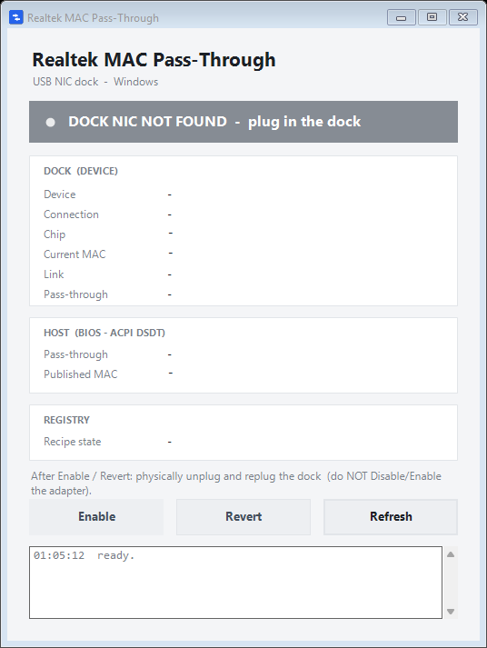

# Realtek USB Dock — MAC Address Pass-Through Enabler (Windows)

Enable **MAC Address Pass-Through** for a USB network dock based on a **Realtek USB NIC**
(RTL8156 / RTL8153 family) on Windows — even for a generic, non-branded dock that the driver
would normally refuse to pass through.


## The problem
Business laptops (Dell, Lenovo, HP) can publish a *pass-through MAC* through firmware
(the BIOS **MAC Address Pass-Through** feature): whatever dock/USB Ethernet you plug in
presents the laptop's identity to the network, so NAC / DHCP / policies recognize the machine.

The Realtek Windows driver reads that MAC from the ACPI **DSDT**, but by default it applies it
**only for docks it recognizes as a branded vendor dock** (Dell/Lenovo). A generic dock
(e.g. WAVLINK) with the *same* Realtek chip is skipped and keeps its own MAC.

This tool flips the driver's built-in override so it applies the firmware-provided MAC
**regardless of dock branding** — a pure, reversible registry change.

## Requirements
- A dock/adapter with a **Realtek USB NIC** (RTL8156 / RTL8156B / RTL8153 …), USB VID `0x0BDA`, using the Realtek Windows driver.
- A host (laptop) with **BIOS "MAC Address Pass-Through" enabled** so firmware publishes the MAC in ACPI DSDT. The tool checks this for you.
- Windows, Administrator rights.

## Usage
Two ways to use it — pick one. Both read everything from the system and are fully reversible.

### GUI  (recommended)
In the **`gui/`** folder, run **`passthrough-GUI.bat`** (it elevates to Administrator). A small window
identifies your dock as a **device** — read live from the system: what it is (e.g. *Thunderbolt 4
DisplayLink dock*), how it is connected (**Thunderbolt** vs plain USB), the **chip + speed**
(e.g. *RTL8156B · 2.5GbE*), its USB id, MAC and link state — alongside the pass-through status
(host + dock, see below), the recipe state, and **Enable / Revert / Refresh** buttons.

### CLI  (scripting / automation)
In the **`cli/`** folder, as Administrator:

| Script | Action |
|---|---|
| `passthrough-ENABLE.bat` | enable pass-through |
| `passthrough-STATUS.bat` | show current state |
| `passthrough-REVERT.bat` | restore the dock's own MAC |

### After Enable / Revert
Physically **unplug and replug the dock** (Thunderbolt/USB) so the driver re-reads the setting,
then verify with `getmac /v` — the Realtek dock NIC now shows the pass-through MAC.

> First time only: enable **MAC Address Pass-Through** in the laptop BIOS (*System Unique MAC Address*
> or *Integrated NIC MAC*), and let Windows install the Realtek driver for the dock.

## Status at a glance
The tool reads this host's **live ACPI DSDT** (standard `GetSystemFirmwareTable` API — nothing hardcoded per
machine) and reports **two independent axes**, because they really are separate things:

- **Host (BIOS):** does the firmware have the pass-through feature, and is it on? — *supported & ON* (publishes a
  MAC) / *supported but OFF* (enable it in BIOS setup) / *no feature at all* (e.g. many desktops & NUCs). Detected
  by the known firmware plumbing: Dell's `AMAC` or Lenovo's `MACA` ACPI object (or an `_AUXMAC_` / `_RTXMAC_` marker).
- **Dock (adapter):** does the dock apply pass-through **natively**, or does it need the registry **recipe**? — a
  branded dock the driver auto-recognizes works on its own; a **generic** dock (same Realtek chip, no vendor marker)
  is skipped by the driver and needs this tool's recipe. When pass-through is active, the tool shows which of the two
  it is; a dormant generic dock just shows *needs recipe (Enable)*.

The top banner is the **combined verdict** and names the bottleneck.

| Host (BIOS) | Dock | Banner |
|---|---|---|
| supported, ON | active, via recipe | 🟢 **PASS-THROUGH ACTIVE** (via this tool) |
| supported, ON | active, native | 🟢 **PASS-THROUGH ACTIVE** (native dock) |
| supported, ON | generic, not applied | 🔵 **READY** — host OK, press Enable |
| supported, OFF | — | 🟠 **ENABLE IN BIOS** — feature present but off |
| no feature | — (dock is fine) | ⚪ **NO HOST PASS-THROUGH** (BIOS limitation) |
| — | not found | ⚪ **DOCK NIC NOT FOUND** |

> On a host with **no** pass-through feature, firmware can't supply a MAC, so there is nothing for this tool to
> apply — the dock itself is fine. If you still want the dock NIC to present a specific MAC on that host (Windows
> only, same as pass-through would achieve), set it manually with the standard Windows adapter property — see
> **[Host without the feature](#host-without-the-feature)**.

The app in each state — native dock (active), ready (host OK / dock needs recipe), host feature off, host has no feature, nothing plugged:

| | |
|:--:|:--:|
|  |  |
|  |  |
|  | |

## How it works (short)
The driver scans the ACPI **DSDT** for a literal string `_AUXMAC_#AABBCCDDEEFF#` placed there by
the firmware, then applies that MAC to the NIC. These per-adapter registry values (REG_DWORD)
tell it to do so regardless of dock brand:

| Value | Set to | Meaning |
|---|---|---|
| `EnableManualCloneMAC` | `1` | Don't auto-detect the vendor by chip — use the registry type |
| `AUXMacType`           | `3` | Treat the dock as pass-through capable (bitmask of both methods) |
| `AUXMacSupportVer`     | `1` | Protocol version |
| `EnableCloneMAC`       | `1` | Enable the clone (already the default) |

The MAC itself always comes from the firmware's DSDT entry — these tools never set a MAC value.
Full mechanism: [`docs/HOW-IT-WORKS.md`](docs/HOW-IT-WORKS.md).

## Scope & limitations
- **Realtek USB NICs only.** Docks with ASIX / Aquantia / other chips use different drivers and are unaffected. The tool acts only on a confirmed Realtek USB adapter (USB vendor `0x0BDA`).
- **The host must publish the MAC.** With BIOS pass-through *disabled* (no `_AUXMAC_` in DSDT) there is nothing to apply; the tool detects this and tells you. Hosts without this firmware feature would need a DSDT override (advanced; out of scope here).
- Verified on a Dell Latitude 5530 + WAVLINK Thunderbolt dock (Realtek RTL8156B), Realtek driver `rtu56cx22x64`. The keys are shared across Realtek's Windows drivers (`rtump*`, `rtu*cx*`).

## Host without the feature
If the tool reports **BIOS HAS NO PASS-THROUGH**, the firmware has no MAC pass-through feature, so there is no
firmware MAC to apply and this tool's Enable does nothing. Pass-through can't be *created* from the OS side
without modifying firmware (out of scope). If you only need the dock NIC to present a specific MAC **in Windows**
(the same practical result pass-through gives — Windows only, not pre-boot/PXE), set it manually with the standard
Windows adapter property, e.g. make the dock present this machine's onboard NIC MAC:

```powershell
# Replace the adapter name and the 12-hex MAC (here: this host's onboard NIC MAC, no separators)
Set-NetAdapterAdvancedProperty -Name 'Ethernet 2' -RegistryKeyword NetworkAddress -RegistryValue 1C697AD98A33
# Undo:
Remove-NetAdapterAdvancedProperty -Name 'Ethernet 2' -RegistryKeyword NetworkAddress
```

This is a plain manual MAC override (a standard Windows feature), **not** firmware pass-through — you pick the MAC
yourself and it does not adapt per host. Fully reversible.

## Safety
- **Do not** use Device Manager "Disable/Enable" or `Disable-NetAdapter` to re-init the card — on some driver versions this triggers a bugcheck (BSOD `WDF_VIOLATION`). **Physically unplug/replug the dock instead.**
- Everything here is a user-space registry change and is fully reversible.

## Linux
The Linux `r8152` driver also supports pass-through, but gates it on the chip's eFuse `PASS_THRU`
bit plus the ACPI method, rather than a Windows-style vendor auto-detect. On hardware whose eFuse
bit is already set it may work out of the box once the host provides the ACPI MAC. A Linux
equivalent / notes are **TODO**.

## References
- Linux kernel `r8152` driver — host MAC pass-through (`drivers/net/usb/r8152.c`, `vendor_mac_passthru_addr_read`).
- Vendor "MAC Address Pass-Through" firmware feature (Dell / Lenovo / HP documentation).
- Microsoft `GetSystemFirmwareTable` API — reading the ACPI DSDT.

## Disclaimer
This project only toggles Realtek driver configuration keywords to enable a firmware feature the
hardware already supports; the MAC itself always comes from your own firmware. Not affiliated with
or endorsed by Realtek, Dell, Lenovo, HP, or WAVLINK. **Use at your own risk.**

## License
MIT — see [LICENSE](LICENSE).
