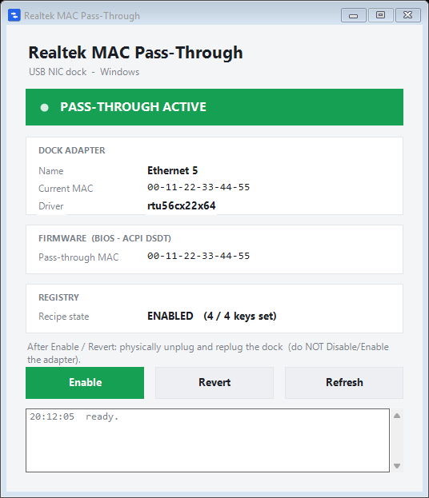

# Realtek USB Dock — MAC Address Pass-Through Enabler (Windows)

Enable **MAC Address Pass-Through** for a USB network dock based on a **Realtek USB NIC**
(RTL8156 / RTL8153 family) on Windows — even for a generic, non-branded dock that the driver
would normally refuse to pass through.

## The problem
Business laptops (Dell, Lenovo, HP) can publish a *pass-through MAC* through firmware
(the BIOS **MAC Address Pass-Through** feature): whatever dock/USB Ethernet you plug in
presents the laptop's identity to the network, so NAC / DHCP / policies recognize the machine.

The Realtek Windows driver reads that MAC from the ACPI **DSDT**, but by default it applies it
**only for docks it recognizes as a branded vendor dock** (Dell/Lenovo). A generic dock
(e.g. WAVLINK) with the *same* Realtek chip is skipped and keeps its own MAC.

This tool flips the driver's built-in override so it applies the firmware-provided MAC
**regardless of dock branding** — a pure, reversible registry change.

## Requirements
- A dock/adapter with a **Realtek USB NIC** (RTL8156 / RTL8156B / RTL8153 …), USB VID `0x0BDA`, using the Realtek Windows driver.
- A host (laptop) with **BIOS "MAC Address Pass-Through" enabled** so firmware publishes the MAC in ACPI DSDT. The tool checks this for you.
- Windows, Administrator rights.

## Quick start
1. In your laptop BIOS, enable **MAC Address Pass-Through** (*System Unique MAC Address* or *Integrated NIC MAC*).
2. Plug in the dock; let Windows install the Realtek driver.
3. Double-click **`passthrough-ENABLE.bat`** (it elevates to admin).
4. **Unplug and replug the dock** (Thunderbolt/USB).
5. Verify: run `getmac /v` — the Realtek dock NIC now shows the pass-through MAC.

- Undo: **`passthrough-REVERT.bat`**
- Inspect only: **`passthrough-STATUS.bat`**

## Graphical version
Prefer a window over scripts? Run **`passthrough-GUI.bat`** (it elevates to admin). A small WinForms
app shows the dock adapter, its current MAC, the pass-through MAC your firmware publishes, the recipe
state, and **Enable / Revert / Refresh** buttons. Everything is read from the system - nothing hardcoded.

### Status at a glance
| Situation | Status shown |
|---|---|
| Firmware provides a MAC, recipe applied | 🟢 **PASS-THROUGH ACTIVE** |
| Firmware provides a MAC, recipe not applied | ⚪ **PASS-THROUGH INACTIVE** (Enable works) |
| Firmware provides no MAC (BIOS feature off or absent) | 🟠 **NO MAC IN FIRMWARE** |
| No Realtek USB dock NIC found | ⚪ **DOCK NIC NOT FOUND** |

## How it works (short)
The driver scans the ACPI **DSDT** for a literal string `_AUXMAC_#AABBCCDDEEFF#` placed there by
the firmware, then applies that MAC to the NIC. These per-adapter registry values (REG_DWORD)
tell it to do so regardless of dock brand:

| Value | Set to | Meaning |
|---|---|---|
| `EnableManualCloneMAC` | `1` | Don't auto-detect the vendor by chip — use the registry type |
| `AUXMacType`           | `3` | Treat the dock as pass-through capable (bitmask of both methods) |
| `AUXMacSupportVer`     | `1` | Protocol version |
| `EnableCloneMAC`       | `1` | Enable the clone (already the default) |

Full mechanism: [`docs/HOW-IT-WORKS.md`](docs/HOW-IT-WORKS.md).

## Scope & limitations
- **Realtek USB NICs only.** Docks with ASIX / Aquantia / other chips use different drivers and are unaffected.
- **The host must publish the MAC.** With BIOS pass-through *disabled* (no `_AUXMAC_` in DSDT) there is nothing to apply; the tool detects this and tells you. Hosts without this firmware feature would need a DSDT override (advanced; out of scope here).
- Verified on a Dell Latitude 5530 + WAVLINK Thunderbolt dock (Realtek RTL8156B), Realtek driver `rtu56cx22x64`. The keys are shared across Realtek's Windows drivers (`rtump*`, `rtu*cx*`).

## Safety
- **Do not** use Device Manager "Disable/Enable" or `Disable-NetAdapter` to re-init the card — on some driver versions this triggers a bugcheck (BSOD `WDF_VIOLATION`). **Physically unplug/replug the dock instead.**
- Everything here is a user-space registry change and is fully reversible.

## Linux
The Linux `r8152` driver also supports pass-through, but gates it on the chip's eFuse `PASS_THRU`
bit plus the ACPI method, rather than a Windows-style vendor auto-detect. On hardware whose eFuse
bit is already set it may work out of the box once the host provides the ACPI MAC. A Linux
equivalent / notes are **TODO**.

## Disclaimer
This project only toggles Realtek driver configuration keywords to enable a firmware feature the hardware already supports; the MAC itself always comes from your own firmware.
Not affiliated with or endorsed by Realtek, Dell, Lenovo, HP, or WAVLINK. **Use at your own risk.**

## References
- Linux kernel `r8152` driver — host MAC pass-through (`drivers/net/usb/r8152.c`, `vendor_mac_passthru_addr_read`).
- Vendor "MAC Address Pass-Through" firmware feature (Dell / Lenovo / HP documentation).
- Microsoft `GetSystemFirmwareTable` API — reading the ACPI DSDT.

## License
MIT — see [LICENSE](LICENSE).
