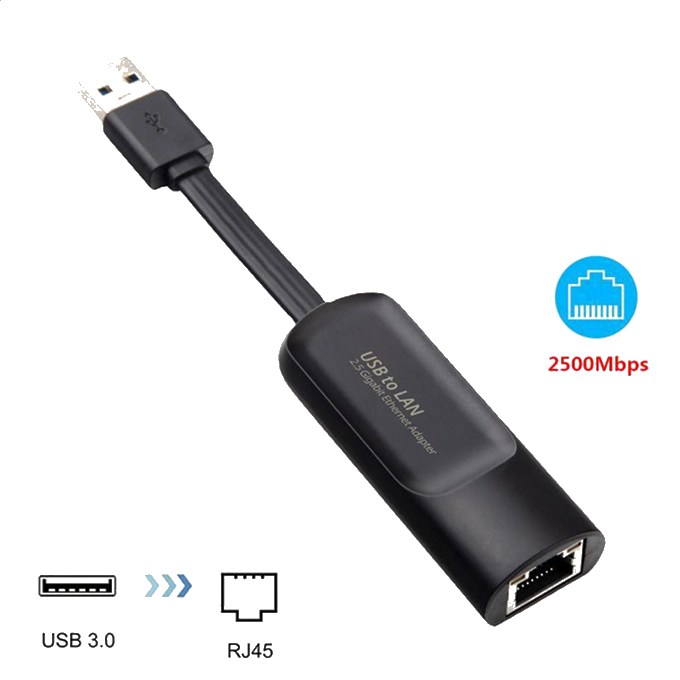
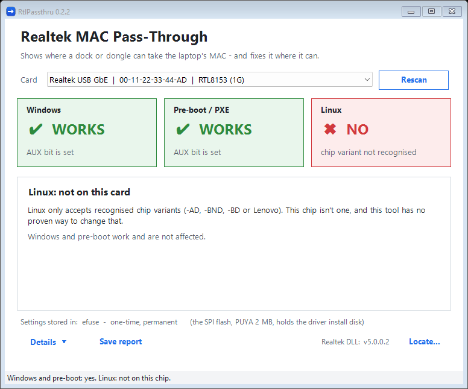

# Enable MAC Address Pass-Through on Thunderbolt / USB docking stations (and dongles)

**Thunderbolt and USB-C docks, and USB Ethernet dongles, often use a Realtek chip for their wired
network. Some ship with MAC Address Pass-Through switched off. RtlPassthru shows where pass-through
works on your adapter — Windows, pre-boot, Linux — and, on RTL8156 chips, switches it on.**

When you dock a laptop, the dock's Ethernet port goes online under *its own* MAC address, not the
laptop's. On corporate and campus networks that breaks things — access control, licensing, DHCP
reservations and PXE/network boot are all tied to the **laptop's built-in** MAC. **MAC Address
Pass-Through** is the fix: the dock borrows the laptop's MAC, so the network sees the same machine
whether you're docked or not. Business laptops offer it through a firmware value called `_AUXMAC_` —
Dell's BIOS setting *"MAC Address Pass-Through"*, and the same feature on Lenovo and HP.

Here's the catch, and the reason this tool exists: **some docks simply don't accept it — and it has
nothing to do with price.** For Windows and pre-boot, the capability is one bit inside the Realtek
chip, and on some units it's left unset at the factory. We hit it on a **premium Thunderbolt 4 dock**.
The good news is that RtlPassthru can burn it in.

| It can't (yet) | …now it can |
|---|---|
|  |  |

> Screenshots use sample data (a made-up MAC). Nothing personal is shown.

---

## How it works

Pass-through needs two things: the laptop offers its MAC (the BIOS option publishes it as
`_AUXMAC_`), and the driver accepts it for this dock. The driver decides by reading registers in the
dock's Realtek chip — and **each system requires different values.** One row is one complete
condition; "—" means not checked:

| System | `0xCFDB` bit 1 | `0xCFDB` bit 0 | `USB_MISC_0 & 0xFEE0` | `USB_MISC_1` bit 2 or bit 0 |
|---|:---:|:---:|:---:|:---:|
| **Windows** | **1** | **1** \* | — | — |
| **Pre-boot / PXE** | **1** | **1** \*\* | — | — |
| **Linux** — chip the driver calls "RTL8153-AD" | — | **1** | **`0x1000`** | — |
| **Linux** — chip it calls "RTL8153-BND" / "-BD" | — | — | — | **1** |

Linux needs **any one** of its two rows; on a Lenovo device (recognised by its USB vendor ID) it
skips these checks altogether.

\* Optional: the Windows driver accepts bit 1 alone or bits 1 and 0 together.

\*\* Tested only with bits 1 and 0 both set; bit 1 alone was not tried.

**Why both bits:** Linux on an "-AD" chip needs bit 0, and pre-boot was proven with both. Writing
`0x03` covers all of them in one burn.

### The `0xCFDB` byte

`0xCFDB` is one byte — eight bits, numbered 7 to 0, each either 0 or 1. Only the two lowest matter
for pass-through:

| Bit | 7 | 6 | 5 | 4 | 3 | 2 | **1** | **0** |
|---|:---:|:---:|:---:|:---:|:---:|:---:|:---:|:---:|
| Hex value | `0x80` | `0x40` | `0x20` | `0x10` | `0x08` | `0x04` | **`0x02`** | **`0x01`** |
| Windows driver | — | — | — | — | — | — | AUX MAC clone | RT MAC clone |
| Realtek | — | — | — | — | — | — | `SELF_POWER` | `DOCKING` |
| Linux driver | — | — | — | — | — | — | — | `PASS_THRU` |
| **Required value** | — | — | — | — | — | — | **1** | **1** |

The other bits are not checked. `0xCFDB` is filled at every power-on: the chip's built-in default,
then any setting records in its efuse on top. The `USB_MISC` registers are set at the factory.

Where the names come from — the chip itself holds only the numbers: **Windows driver** — its log
messages *"Is AUX / RT MAC clone support system"* (`rtump64x64.sys`, `NIC_QuerySpecificHwCaps`);
**Realtek** — its configuration fields; **Linux driver** — the defines and comments in
`drivers/net/usb/r8152.c`, which also name the variants "RTL8153-AD", "-BND" and "-BD".

**What RtlPassthru does:** it reads these registers and shows, per system, whether pass-through will
work. If bit 1 of `0xCFDB` is missing, it burns `0xCFDB = 0x03` (both bits) into the chip's efuse. It
does not change the `USB_MISC` registers. Confirmed: a burned RTL8156 (its `USB_MISC_0` reads
`0x1000`) takes the laptop's MAC in Windows, at Dell pre-boot and on Linux (Ubuntu).

Each system's check, with the Linux code quoted, is in
**[How MAC Pass-Through Works](docs/how-mac-passthrough-works.md)**.

**Why it's a "burn".** The efuse is one-time-programmable (OTP) memory: each bit can be set once and
never cleared. RtlPassthru doesn't edit anything that is there; it **appends one 4-byte record
(`40 CF DB 03`) into blank space** right after the existing records, reads it back to verify, and the
chip applies it at every power-on. Because it can't be undone, the tool always shows a **preview**
first and writes only after you confirm.

### What it can do on which chip

| Chip | Reads & diagnoses | Burns `0xCFDB = 0x03` |
|---|:---:|:---:|
| **RTL8156** (2.5 G) | ✓ | ✓ |
| **RTL8153** (1 G) | ✓ | — its efuse uses a different protocol; read-only for now |

---

## The dock that started this

The one that set this off was not a bargain-bin part — it was the **WAVLINK ThunderDock Quattuor Pro
(WL-UTD41)**, a premium 40 Gbps, 15-in-1 Thunderbolt 4 docking station
([WAVLINK](https://www.wavlink.com/en_us/product/WL-UTD41.html) ·
[Amazon](https://www.amazon.co.uk/dp/B0CMHN2MZH)).


*Photo: WAVLINK (manufacturer). Source: the product pages linked above.*

Its 2.5 Gigabit Ethernet is a **Realtek RTL8156** — WAVLINK's spec sheet never names the chip; we
found it by reading the controller directly. Its `0xCFDB` read **`0x01`**: bit 0 set, bit 1 not set
— and on a Dell with *MAC Address Pass-Through* enabled, this expensive dock did **not** take the
laptop's MAC, in Windows or at pre-boot. We burned `0x03`; it now reads **`0x03`** and passes
the MAC through, including Dell's pre-boot pass-through. **Even a premium dock can ship without it.**

**Not sure about yours? Try it on a dongle first.** A cheap USB 2.5G dongle
([a few pounds on AliExpress](https://www.aliexpress.com/item/1005009390264219.html)) uses the very
same RTL8156 chip, so we ran the whole read → preview → burn flow on it first — it enabled
pass-through and **kept working perfectly afterwards.** It's an easy, low-cost way to get
comfortable with the process before touching an expensive dock.



*An inexpensive USB-A 2.5G dongle with the same Realtek RTL8156 as the dock — a handy thing to try
the process on first. Photo: AliExpress listing (linked above).*

---

## Setup

RtlPassthru runs on **Windows x64** and needs **[Python 3.8+](https://www.python.org/downloads/)**
installed — it won't run without it (standard library only, nothing to `pip install`). Your adapter
must also be on a **genuine Realtek driver** (the `rtump64x64` family — it appears as
*"Realtek … USB … Family Controller"*); the generic Microsoft USB driver won't work. Windows Update
usually installs a Realtek one on its own, and if it didn't, you can grab it from the same Realtek
page as the DLL in step 2.

Then:

1. **Get RtlPassthru.** Download the latest **[release](../../releases)** `.zip` and unzip it anywhere
   (or clone this repo).

2. **Add the Realtek DLL.** RtlPassthru drives Realtek's own diagnostic library
   (`RtlDirectDiagLib64.dll` with its companion `RTDiagLibV2.dll`) — Realtek's property, so it is
   **not bundled here.** Grab your own copy (one free download):
   - Open Realtek's **USB Ethernet Family Controller Software** page:
     <https://www.realtek.com/download/List?cate_id=585>
   - Download the **Ethernet Diagnostic Program** (we used **v2.0.8.3**, ~11 MB) and unzip it.
   - From its **`EXE\64\`** folder, copy **both** `RtlDirectDiagLib64.dll` and `RTDiagLibV2.dll` into
     RtlPassthru's **`dll/`** folder.

3. **Run `Card-Inspector.bat`.** It elevates to Administrator and opens the window.

> RtlPassthru finds the DLL by its exported command set and shows the version it uses at the bottom of
> the window; if it's somewhere else, point at it with **Locate…**.

## Using it

**Pick your adapter.** The card is read as soon as you select it. Three tiles answer the real
question — **does pass-through work, and where:** **Windows**, **Pre-boot / PXE** and **Linux**,
each green **WORKS** or red **NO**, with the reason underneath (the two screenshots at the top).
Each system checks different registers in the chip, so the tiles can differ.

Below the tiles, **one action card** offers what fits *this* card:

- **Enable pass-through** — when bit 1 of `0xCFDB` (the AUX bit) is not set (the red screenshot at the
  top). Two steps:
  - **1 · Preview** — Preview reads the chip, finds the free slot in the efuse and shows the exact
    record it *would* write — **without touching anything.** The Burn button unlocks only after a
    successful preview.

    

  - **2 · Burn AUX bit** — confirm in the dialog and keep the adapter plugged in while a progress
    bar shows it writing and verifying (the window can't be closed mid-write). Then **unplug and
    re-plug** it, so the chip reloads its efuse, and press **Rescan**. The Windows and pre-boot
    tiles should turn green — and Linux too, if the chip passes Linux's `USB_MISC` test.
- **Nothing to do** — everything already works.
- **Linux: not on this card** — Windows and pre-boot work, but the chip's `USB_MISC` registers fail
  Linux's variant test (`-AD`, `-BND`, `-BD`) and it isn't a Lenovo device. Those registers are set at
  the factory; the tool says so plainly rather than offering a fix it can't prove.

  

**Details ▾** opens a panel under the window with two tabs: *Markers & registers* (every register
each system checks, and its value) and *Settings dump* — the chip's efuse in hex with its setting records
decoded and summarised in plain words (and, if the card has an SPI flash, the start of it — on the
cards we read that flash holds the driver install disk, not chip settings). **Save report** writes
all of it to a text file.


---

## Deep dive

The mechanism in full, for anyone who wants it.

**From efuse to the Windows driver.** At each power-on `0xCFDB` starts at the chip's built-in default
and is then overwritten by any `40 CF DB XX` record in the efuse (the last one wins). The Windows
driver (`rtump64x64`) reads `0xCFDB` and builds its own internal byte, `AUXMacType` — **swapping the
weight of the two bits** as it does:

```
0xCFDB  bit 0  "Is RT MAC clone support system"   ->  AUXMacType |= 2
0xCFDB  bit 1  "Is AUX MAC clone support system"  ->  AUXMacType |= 1   <- the driver tests this one (& 1)
```

The Windows driver applies pass-through for exactly `AUXMacType & 1`, and that bit is fed **only** by
`0xCFDB` bit 1. So a factory `0x01` becomes `AUXMacType = 2` (no pass-through), and `0x03` becomes
`AUXMacType = 3` (pass-through).

**It works below the OS, not just inside it.** The values live in the chip itself, so pass-through
isn't tied to any one operating system:

- **Pre-boot / PXE** — the laptop's firmware gives the card the laptop's MAC *before any OS loads*.
  We tested this on a Dell with BIOS *MAC Address Pass-Through* enabled: the dock took the MAC with
  `0x03` and did not with `0x01`.
- **Windows** — the Realtek driver reads `0xCFDB`, derives `AUXMacType`, and clones the `_AUXMAC_` MAC.
- **Linux** — the `r8152` driver applies the host MAC too, *when the chip passes its `USB_MISC` test*.
  Confirmed: our burned RTL8156 (`USB_MISC_0 = 0x1000`) came up under the laptop's MAC on Ubuntu,
  while an RTL8153 with `USB_MISC_0 = 0x0000` and no BND/BD bit kept its own MAC.

Because the capability sits in the hardware, network boot already sees the laptop's identity — which
is what makes this useful for imaging and deployment, not just day-to-day docking.

**How we found it.** We read the chip's registers directly over its USB-OCP interface (reproducible,
cross-checked against the device revision), decompiled the Windows driver to see exactly which bit it
tests, and read the Linux driver's source for its gate.

---

## ⚠️ Safety & disclaimer

- The burn is a **one-time, irreversible (OTP)** write. **Rehearse on a spare first** — a cheap
  RTL8156 dongle is the ideal practice target before an expensive dock.
- It only ever writes into confirmed-blank space, **never over factory data**, and reads the record
  back to verify it.
- Keep the USB connection stable during the burn.
- **It worked for us, but you use this entirely at your own risk — no warranty of any kind.** See
  [LICENSE](LICENSE).

## Under the hood

A thin, layered design — a PowerShell/WinForms window over a small Python backend that talks to the
Realtek library through `ctypes`:

```
Card-Inspector.bat     launcher (self-elevates to admin)
card-inspector.ps1     the window (PowerShell / WinForms)
tools/                 Python backend:
  diag.py                read registers (REV, USB_MISC, 0xCFDB) and the per-system verdict
  settings.py            read-only settings dump: efuse (RTL8156 and RTL8153 protocols) + SPI flash start
  efuse.py               efuse dump / preview / burn (RTL8156-family efuse)
  rtldiag.py             unified DLL layer (classifies + drives the Realtek library)
  passthru.py            which registers each system checks -> the verdict (unit-tested)
  storage.py             where the settings live (unit-tested)
  efuse_core.py          pure efuse record logic (unit-tested)
  dll_list.py            lists/classifies the DLLs by command set
tests/                 regression tests  ->  python -m pytest
dll/                   you place the Realtek diag DLL here (not shipped)
```

It reads `0xCFDB` over the chip's USB-OCP interface and, for the burn, drives the efuse controller
with the library's register primitives — appending the record and verifying it by reading it back.

## Command line (optional)

The window is just a front end — the Python backend runs standalone (same Administrator and DLL
requirements), which is handy for scripting or a headless box:

```powershell
python -I tools/diag.py  {InterfaceGuid}            # read REV, USB_MISC and 0xCFDB, per-system verdict
python -I tools/settings.py {InterfaceGuid}         # settings dump: efuse records + plain-words summary
python -I tools/efuse.py {InterfaceGuid}            # dump the efuse (RTL8156 family)
python -I tools/efuse.py {InterfaceGuid} --plan     # preview: show what a burn would write
python -I tools/efuse.py {InterfaceGuid} --burn     # burn 0xCFDB = 0x03   (irreversible)
python -I tools/dll_list.py                         # list / classify the Realtek DLLs found
```

Get the adapter's GUID with `(Get-NetAdapter).InterfaceGuid`. Add `--dll new|old|auto` to pick a
specific library.
