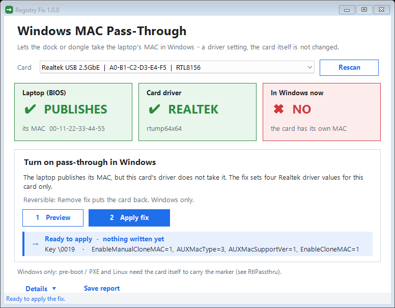
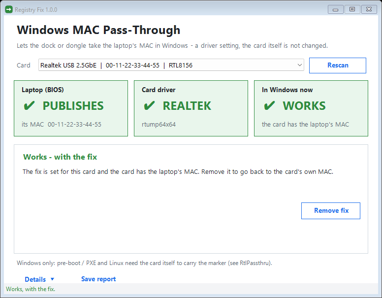
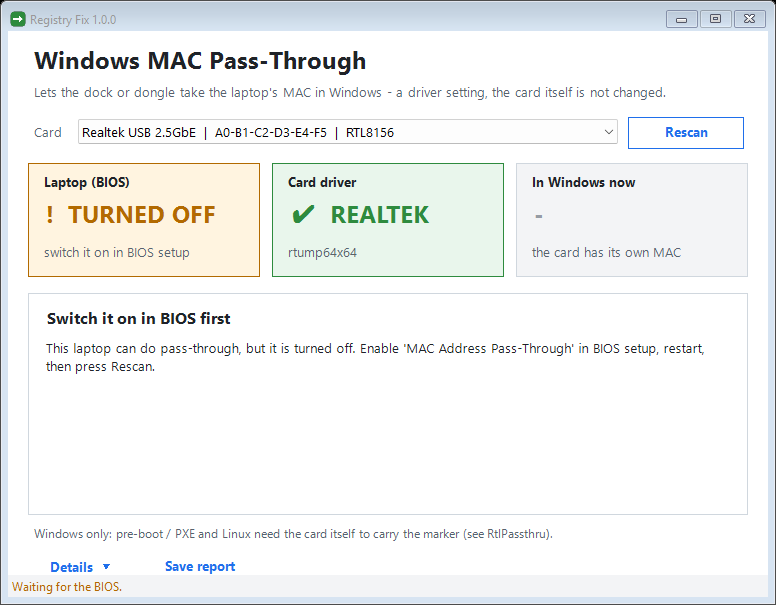

# Registry Fix — MAC pass-through in Windows, without changing the card

A small Windows tool for a Realtek USB network card — in a dock or a dongle — on a laptop whose BIOS offers
**MAC Address Pass-Through** (Dell and others). It checks whether the card takes the laptop's MAC in Windows,
and if it doesn't, turns it on with four Realtek driver settings for that card. **The card itself is not
changed**, and **Remove fix** puts everything back.

## What it checks

| Tile | Question |
|---|---|
| **Laptop (BIOS)** | Does the BIOS publish its pass-through MAC? (*publishes* / *turned off* in BIOS setup / *no* such feature) |
| **Card driver** | Is the card on Realtek's driver? The fix is a Realtek driver setting; Microsoft's generic driver ignores it. |
| **In Windows now** | Does the card have the laptop's MAC right now? |

Below the tiles, one card shows only what fits: **1 · Preview → 2 · Apply fix**, **Remove fix** when the fix is
set, *Nothing to do* when the card already takes the MAC on its own, or what to change in the BIOS first.

## How to use

1. Start **`Registry-Fix.bat`** — it asks for administrator rights (the fix is written to the registry).
2. Pick the card, press **1 · Preview**, then **2 · Apply fix**.
3. **Unplug the dock or dongle and plug it back in** — the driver reads its settings when the card starts.
   (Don't disable / enable the adapter in Windows; re-plug it.)
4. Press **Rescan**: *In Windows now* should turn green.

No Python and no Realtek DLL needed — only Windows PowerShell, which every Windows has.

## What it changes

Four `REG_DWORD` values in this one card's driver key,
`HKLM\SYSTEM\CurrentControlSet\Control\Class\{4d36e972-e325-11ce-bfc1-08002be10318}\<NNNN>`:

| Value | Set to |
|---|---|
| `EnableManualCloneMAC` | `1` |
| `AUXMacType` | `3` |
| `AUXMacSupportVer` | `1` |
| `EnableCloneMAC` | `1` |

The MAC itself always comes from the laptop's BIOS (its ACPI table); the tool never sets a MAC address.
**Details** shows the key, each value now and what the fix sets, and **Save report** writes it to a file.

## Good to know

- **Windows only.** Before Windows starts (pre-boot / PXE) and on Linux the card decides by itself, from a
  marker in its own chip — that is what **RtlPassthru** (the main tool in this repository) checks and fixes.
- A **driver update or reinstall** can reset the driver settings; run the tool again if the MAC is back to the card's own.
- If a **manual MAC** (*Network Address*) is set for the card, it overrides pass-through — the tool points it out.

⚠️ No warranty: use at your own risk. The change is limited to the four values above and is fully reversible.
